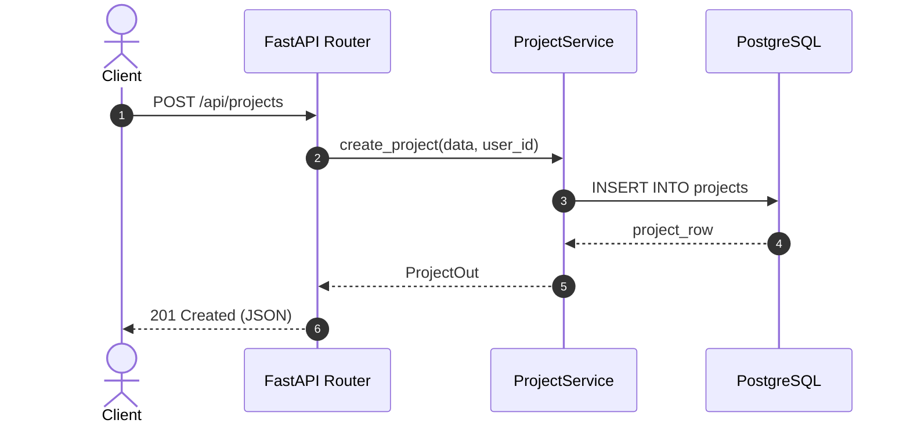

# CodeRabbit AI Code Review Skill

This skill delivers structured, high-signal, context-aware code reviews modeled after CodeRabbit AI. It analyzes pull requests, git diffs, and staged commits to detect logic regressions, security flaws, edge cases, and performance regressions while offering drop-in actionable fixes.

---

## 1. Review Methodology & Priorities

Review changes in the following strict priority order:

1. **🔴 Critical / Blocker**:
   - Security vulnerabilities (SQL injection, auth bypass, IDOR, secret leaks).
   - Logic bugs, data corruption, broken transactions, race conditions.
   - Breaking API changes or schema mismatches.
2. **🟠 Major / Quality**:
   - Unhandled exception paths or null pointer / `NoneType` dereferences.
   - Resource leaks (unclosed DB connections, lingering tasks, file handles).
   - Missing unit or regression tests for new flows.
3. **🟡 Minor / Optimizations**:
   - Inefficient algorithmic complexity ($O(N^2)$ lookups in loops, redundant DB queries).
   - Code cleanliness, naming, type hints, docstring clarity.
4. **🟢 Praise**:
   - Commendable architectural patterns, defensive checks, and thorough test cases.

---

## 2. Review Structure Standard

Every comprehensive review generated with this skill must follow the standard CodeRabbit format:

### A. Walkthrough & Summary
Provide a concise overview of the PR's intent, followed by a bulleted summary grouped by feature area or package.

### B. Sequence / Architecture Diagram (Mermaid)
For PRs introducing new workflows, API calls, or asynchronous jobs, generate a Mermaid sequence diagram illustrating the changed flow:



### C. Assessment Matrix

| Category | Status | Notes |
| :--- | :--- | :--- |
| **Correctness & Logic** | ✅ Pass / ⚠️ Issues Found | Summary of logic checks |
| **Security & Auth** | ✅ Pass / ⚠️ Vulnerability | Differential auth & sanitization check |
| **Performance** | ✅ Pass / ⚠️ Regressions | Query efficiency & async non-blocking checks |
| **Test Coverage** | ✅ Adequate / ⚠️ Missing | Verification of unit/integration coverage |

### D. Actionable Line-by-Line Comments

Provide targeted comments mapped to specific file lines. Each comment that suggests a change MUST provide a drop-in replacement snippet with clear rationale:

````markdown
> `controllers/project_controller.py:84`

**Issue**: Missing ownership filter allows users to query projects from other tenants (IDOR risk).

**Suggested Fix**:
```python
# Before:
# query = select(Project).where(Project.id == project_id)

# After:
query = select(Project).where(
    Project.id == project_id,
    Project.organization_id == current_user.organization_id
)
```
````

See [review_template.md](./references/review_template.md) for the complete PR review markdown template.

