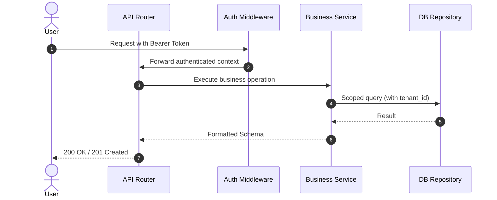

# CodeRabbit PR Review Template

Use this markdown template when rendering a complete CodeRabbit-style pull request review.

---

## 🐇 CodeRabbit Code Review

### Summary of Changes
<!-- Concise paragraph summarizing the goal of the PR -->

#### Key Changes:
- **`app/api/`**: Refactored route handlers to use async dependency injection.
- **`app/services/`**: Added tenant boundary verification before querying database.
- **`tests/`**: Added integration regression tests for multi-tenant isolation.

---

### 🔄 Architectural Flow


---

### 📊 Assessment Matrix

| Dimension | Status | Comments |
| :--- | :--- | :--- |
| **Logic & Correctness** | 🟢 Clean | Logic flows correctly handle edge cases. |
| **Security & Privacy** | 🟠 Needs Attention | Ensure tenant isolation is enforced on batch delete endpoints. |
| **Performance** | 🟢 Optimized | Non-blocking async queries with indexed filters. |
| **Test Coverage** | 🟢 Excellent | Includes positive, negative, and edge-case unit tests. |

---

### 📝 Line-by-Line Review Comments

#### 🔴 Critical Issues
<!-- Critical bugs, security vulnerabilities, or data loss hazards -->
*None.*

#### 🟠 Major Suggestions
> **[Filename.py:Line]**  
> **Finding**: Unhandled `None` case when item is not found in cache.  
> **Recommendation**: Handle cache miss by fetching from persistence layer.  
> ```python
> if cached_item is None:
>     cached_item = await db.get(item_id)
> ```

#### 🟡 Minor / Code Polish
> **[Filename.py:Line]**  
> **Finding**: Variable naming could be more descriptive.  
> **Recommendation**: Rename `tmp` to `parsed_token_payload`.

---

### 💬 Final Verdict
- [ ] Needs Work before merge
- [x] Approve with minor adjustments

