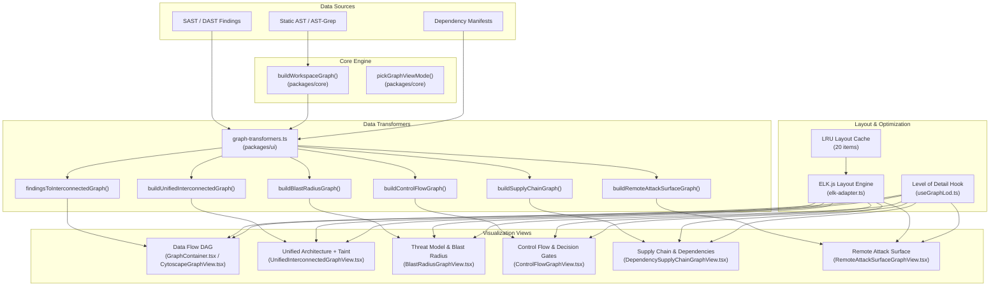

# Codefy Graph System: Architecture & Component Catalog

This document provides a comprehensive, file-by-file analysis of the graph visualization and analysis subsystems across the Codefy monorepo. It details every type contract, AST builder, graph transformation pipeline, visualization view, custom node/edge component, and layout algorithm used.

---

## 1. Architectural Overview & Component Map

The Codefy graph system visualizes codebase architecture, dataflow taint traces, threat models, sanitizer decision gates, supply chain dependencies, and remote DAST attack surfaces.



---

## 2. File-by-File Breakdown

### 2.1 Type Contracts & Data Models (`packages/types`)

#### [packages/types/src/graph.ts](file:///Users/jayesh/Documents/codefy/packages/types/src/graph.ts)
The authoritative single source of truth for graph interfaces across the monorepo:

* **`GraphNodeRole`**:
  * `"source"`: Taint origin point (user input, HTTP param, request header).
  * `"sink"`: Vulnerable execution point (SQL query, `eval`, shell exec, innerHTML).
  * `"sanitizer"`: Neutralizing validation filter or escape guard.
  * `"passthrough"`: Intermediate data propagation step or AST function/file node.
  * `"group"`: Structural container grouping nodes by source file.
  * `"cluster"`: Collapsed visual chip summarizing multiple intermediate hops.
  * `"annotation"`: Advisory card or remediation hint attached to high/critical sinks.
  * `"boundary"`: Perimeter zone enclosing trust environments (Ingress, DMZ, Core, Vault).
  * `"asset"`: High-value database, credential store, or system asset.
  * `"decision"`: Branching decision gate evaluating sanitization conditions.
  * `"safe_exit"`: Terminal validation exit path (e.g. 400 Bad Request, early return).
  * `"package"`: External third-party dependency module.
  * `"endpoint"`: Discovered HTTP route or API endpoint.
  * `"probe"`: Dynamic DAST vulnerability verification probe.
* **`GraphNode`**:
  ```typescript
  export interface GraphNode {
    readonly id: string;
    readonly role: GraphNodeRole;
    readonly label: string;
    readonly filePath: string;
    readonly line: number;
    readonly parentId?: string;
    readonly extent?: "parent";
    readonly width?: number;
    readonly height?: number;
    readonly collapsed?: boolean;
    readonly metadata?: Readonly<Record<string, unknown>>;
  }
  ```
* **`GraphEdgeType`**:
  * `"taint"`, `"pulse"`, `"step"`, `"contains"`, `"defines"`, `"calls"`, `"originates_in"`, `"sinks_at"`, `"flows_through"`, `"threat_vector"`, `"branch_true"`, `"branch_false"`, `"depends_on"`, `"hosts"`, `"exposes"`, `"probes"`.
* **`GraphEdge`**:
  Includes `id`, `source`, `target`, `label`, `tainted`, `type`, `animated`, and `data` carrying payload expressions and severity weights.
* **`WorkspaceGraph` & `UnifiedGraph`**:
  Defines `WorkspaceGraphNode` (`directory`, `file`, `class`, `function`, `module`) and `WorkspaceGraphEdge` (`contains`, `imports`, `calls`, `defines`).

#### [packages/types/src/chat-query.ts](file:///Users/jayesh/Documents/codefy/packages/types/src/chat-query.ts)
* **`ChatGraphViewMode`**:
  Union of the 6 view identifiers: `"graph" | "unified" | "blast_radius" | "control_flow" | "supply_chain" | "remote"`.
* **`ChatResult` & `StreamingChatChunk`**:
  Contains `graphViewMode` instructing the UI shell which visualization to switch to in response to natural-language chat queries.

---

### 2.2 Core Graph Building & Query Resolution (`packages/core`)

#### [packages/core/src/graph/workspace-graph.ts](file:///Users/jayesh/Documents/codefy/packages/core/src/graph/workspace-graph.ts)
Constructs the architectural workspace dependency and symbol graph across 4 phases:
1. **Phase 1: Directory & File Hierarchy**:
   Recursively parses paths and generates directory nodes (`dir:...`) and file nodes (`file:...`), linked by `contains` edges.
2. **Phase 2: Universal Multi-Language Symbol Extraction**:
   Uses fast-path skips and regex extractors to identify classes, structs, interfaces, functions, methods, and arrow functions across TypeScript/JavaScript, Python, Go, Kotlin, Swift, and Rust. Maps finding occurrences to exact functions and generates `defines` edges.
3. **Phase 3: Module Imports Resolution**:
   Scans `import ... from ...` and `require(...)` statements and resolves candidate files in $O(1)$ time via a precomputed `filesByBasename` index, emitting `imports` edges.
4. **Phase 4: Function Call Connections**:
   Extracts identifier call expressions inside function bodies and generates `calls` edges linking caller to callee.

#### [packages/core/src/query/graph-view-picker.ts](file:///Users/jayesh/Documents/codefy/packages/core/src/query/graph-view-picker.ts)
Deterministic routing function `pickGraphViewMode(ast, finding)`:
* Routes DAST / orchestrator findings to `"remote"`.
* Routes `SHOW_GRAPH_PATH` to `"graph"`.
* Routes `EXPLAIN_FINDING` with sanitizers to `"control_flow"`.
* Routes supply chain queries (`"depend"`, `"package"`, `"supply chain"`) to `"supply_chain"`.
* Routes blast radius queries (`"affect"`, `"impact"`, `"blast"`, `"downstream"`) to `"blast_radius"`.
* Fallbacks to `"graph"`.

---

### 2.3 Graph Data Transformers (`packages/ui/src/visualization/graph-transformers.ts`)

This 974-line file transforms raw security findings and workspace structures into positioned graph datasets:

1. **`findingsToInterconnectedGraph(findings, options)`**:
   * Deduplicates identical sources and sinks across multiple findings into shared nodes.
   * Visualizes converging paths (multiple sources leading into one sink) and diverging paths (one source triggering multiple sinks).
   * Generates file subflow parent containers (`GroupContainerNode`) when `groupByFile: true`.
   * Attaches advisory `AnnotationNode`s to high/critical sinks when `showAnnotations: true`.
2. **`buildUnifiedInterconnectedGraph(workspaceGraph, findings, options)`**:
   * Combines whole-codebase architecture (folders, files, functions) with security taint traces.
   * Links function nodes to taint steps using `originates_in`, `sinks_at`, and `flows_through` edges.
3. **`buildBlastRadiusGraph(findings, workspaceGraph, options)`**:
   * Constructs a 4-tier threat model architecture:
     * **Public Ingress Zone** (`zone-ingress`): External inputs & entry points.
     * **DMZ & Gateway Zone** (`zone-dmz`): Reverse proxies, auth, sanitizers.
     * **Core Application Zone** (`zone-core`): Business logic, controllers, routing.
     * **Sensitive Asset Vault** (`zone-vault`): High-value databases, shells, secrets.
   * Maps sinks to `AssetNode`s marked as `compromised_asset` with animated `threat_vector` edges.
4. **`buildControlFlowGraph(finding)`**:
   * Builds the condition gate logic:
     $$\text{Source} \longrightarrow \text{Decision Node } (\text{isSanitized}) \begin{cases} \xrightarrow{\text{[True]}} \text{Safe Exit (400 Bad Request)} \\ \xrightarrow{\text{[False]}} \text{Vulnerable Sink (Bypass Path)} \end{cases}$$
5. **`buildSupplyChainGraph(workspaceGraph, findings, options)`**:
   * Maps external packages (`PackageNode`) and workspace modules to consuming source files (`PassthroughNode`), highlighting vulnerable dependencies with pulsing edges.
6. **`buildRemoteAttackSurfaceGraph(findings, targetHost, options)`**:
   * Discovers and lays out live DAST endpoints:
     $$\text{Target Host Boundary} \longrightarrow \text{Endpoint Nodes (GET/POST/etc.)} \longrightarrow \text{Exploit Probe Nodes}$$
7. **Utilities**:
   * `isTestFilePath` & `filterWorkspaceGraphTestFiles`: Prunes test directories/files from whole-code graphs.
   * `parseEndpointInfo`: Normalizes URLs, HTTP methods, hostnames, and ports.

---

### 2.4 Layout Engines & Optimization Hooks

#### [packages/ui/src/visualization/elk-adapter.ts](file:///Users/jayesh/Documents/codefy/packages/ui/src/visualization/elk-adapter.ts)
* Wraps `elkjs/lib/elk.bundled.js` to perform synchronous, in-process graph layout.
* Handles compound parent-child hierarchies (e.g. subflow groups, trust boundary containers) by positioning child nodes relative to parent coordinates.
* Implements an **LRU Layout Cache** (capacity: 20) with deterministic signature keys to eliminate re-computation overhead on unchanged graphs (0ms instant re-renders).

#### [packages/ui/src/visualization/elk-layout-config.ts](file:///Users/jayesh/Documents/codefy/packages/ui/src/visualization/elk-layout-config.ts)
* Configures ELK's `layered` layout algorithm with `BRANDES_KOEPF` node placement.
* Declares standard layout spacing and precise dimensional bounds via `ROLE_DIMENSIONS`:
  * Default node: $250 \times 68\text{ px}$
  * Annotation: $260 \times 96\text{ px}$
  * Decision gate: $240 \times 76\text{ px}$
  * Asset node: $260 \times 72\text{ px}$
  * Group container: $340 \times 180\text{ px}$
  * Trust boundary: $380 \times 220\text{ px}$

#### [packages/ui/src/visualization/useGraphLayout.ts](file:///Users/jayesh/Documents/codefy/packages/ui/src/visualization/useGraphLayout.ts)
* React hook running layout off the main render thread.
* Tracks incrementing `requestIdRef` to prevent race conditions from stale layout computations.

#### [packages/ui/src/visualization/useGraphLod.ts](file:///Users/jayesh/Documents/codefy/packages/ui/src/visualization/useGraphLod.ts)
* **Level of Detail (LOD)** performance hook.
* Subscribes to React Flow's zoom transform via Zustand boolean selector at threshold `0.45`.
* When zoom $< 45\%$, switches all nodes and edges to lightweight vector chips with zero DOM label overhead, ensuring 60 FPS on large graphs.

#### [packages/ui/src/visualization/zoom-config.ts](file:///Users/jayesh/Documents/codefy/packages/ui/src/visualization/zoom-config.ts)
* `GRAPH_MIN_ZOOM`: `0.05` (5% overview for massive codebases).
* `GRAPH_MAX_ZOOM`: `4.0` (400% deep zoom into code tokens).
* `GRAPH_DEFAULT_ZOOM`: `0.30` (30% default overview).
* `LOD_COMPACT_ZOOM_THRESHOLD`: `0.45` (45% threshold).
* `GRAPH_ZOOM_TRANSITION_MS`: `250ms` smooth easing.

---

### 2.5 The 6 Graph Visualization Modes

| Mode ID | Component | File | Description & Key Features |
| :--- | :--- | :--- | :--- |
| **`graph`** | `GraphContainer` / `CytoscapeGraphView` | [GraphContainer.tsx](file:///Users/jayesh/Documents/codefy/packages/ui/src/visualization/GraphContainer.tsx), [CytoscapeGraphView.tsx](file:///Users/jayesh/Documents/codefy/packages/ui/src/visualization/CytoscapeGraphView.tsx), [GraphView.tsx](file:///Users/jayesh/Documents/codefy/packages/ui/src/visualization/GraphView.tsx) | Interconnected taint-flow DAG. Supports React Flow or Cytoscape engine switching, bidirectional upstream/downstream BFS path highlighting, breadcrumb navigator, and MiniMap. |
| **`unified`** | `UnifiedInterconnectedGraphView` | [UnifiedInterconnectedGraphView.tsx](file:///Users/jayesh/Documents/codefy/packages/ui/src/visualization/UnifiedInterconnectedGraphView.tsx) | Blends directory, file, and function architecture with security taint paths. Features severity filter dropdown and $O(V' + E')$ adjacency-list BFS highlighting. |
| **`blast_radius`** | `BlastRadiusGraphView` | [BlastRadiusGraphView.tsx](file:///Users/jayesh/Documents/codefy/packages/ui/src/visualization/BlastRadiusGraphView.tsx) | 4-tier trust boundary model (Ingress, DMZ, Core, Vault) showing threat vectors reaching sensitive assets. |
| **`control_flow`** | `ControlFlowGraphView` | [ControlFlowGraphView.tsx](file:///Users/jayesh/Documents/codefy/packages/ui/src/visualization/ControlFlowGraphView.tsx) | Decision gate diagram showing conditional branches: Safe Exit vs Bypass Exploit Vector. Supports `DOWN` and `RIGHT` orientations. |
| **`supply_chain`** | `DependencySupplyChainGraphView` | [DependencySupplyChainGraphView.tsx](file:///Users/jayesh/Documents/codefy/packages/ui/src/visualization/DependencySupplyChainGraphView.tsx) | Visualizes external packages, categories, and vulnerability metrics linked to consuming source files. |
| **`remote`** | `RemoteAttackSurfaceGraphView` | [RemoteAttackSurfaceGraphView.tsx](file:///Users/jayesh/Documents/codefy/packages/ui/src/visualization/RemoteAttackSurfaceGraphView.tsx) | DAST reconnaissance topology mapping Target Host $\rightarrow$ Discovered HTTP/API Endpoints $\rightarrow$ Active Exploit Probes. |

---

### 2.6 Custom Graph Nodes (`packages/ui/src/visualization/nodes/`)

1. **[SourceNode.tsx](file:///Users/jayesh/Documents/codefy/packages/ui/src/visualization/nodes/SourceNode.tsx)**: Untrusted taint origin point. Blue/cyan border, radio antenna icon, multi-directional handles, LOD compact mode.
2. **[SinkNode.tsx](file:///Users/jayesh/Documents/codefy/packages/ui/src/visualization/nodes/SinkNode.tsx)**: Vulnerable execution sink. Red border, alert triangle, CWE badge, critical severity styling, output handles for annotations.
3. **[SanitizerNode.tsx](file:///Users/jayesh/Documents/codefy/packages/ui/src/visualization/nodes/SanitizerNode.tsx)**: Validation filter. Emerald green border, shield check icon, guard pill badge.
4. **[PassthroughNode.tsx](file:///Users/jayesh/Documents/codefy/packages/ui/src/visualization/nodes/PassthroughNode.tsx)**: Intermediate propagation hop or codebase file/function node.
5. **[DecisionNode.tsx](file:///Users/jayesh/Documents/codefy/packages/ui/src/visualization/nodes/DecisionNode.tsx)**: Conditional diamond guard (`isSanitized(...)`). True branch outputs to left/bottom; False/bypass branch outputs to right.
6. **[AssetNode.tsx](file:///Users/jayesh/Documents/codefy/packages/ui/src/visualization/nodes/AssetNode.tsx)**: Sensitive vault asset (Database, Secret Store). Shows "Compromised" pulsing indicator when reached by critical findings.
7. **[EndpointNode.tsx](file:///Users/jayesh/Documents/codefy/packages/ui/src/visualization/nodes/EndpointNode.tsx)**: Discovered API route. Color-coded method badges (`GET`, `POST`, `PUT`, `DELETE`, `GRAPHQL`) and vulnerability indicators.
8. **[GroupContainerNode.tsx](file:///Users/jayesh/Documents/codefy/packages/ui/src/visualization/nodes/GroupContainerNode.tsx)**: Glassmorphic compound container grouping steps by file with collapse toggle and flaw count badge.
9. **[TrustBoundaryNode.tsx](file:///Users/jayesh/Documents/codefy/packages/ui/src/visualization/nodes/TrustBoundaryNode.tsx)**: Dashed perimeter box representing Ingress, DMZ, Core, or Secure Vault zones.
10. **[HopsClusterNode.tsx](file:///Users/jayesh/Documents/codefy/packages/ui/src/visualization/nodes/HopsClusterNode.tsx)**: Collapsed chip summarizing intermediate propagation steps (`+N intermediate hops`).
11. **[AnnotationNode.tsx](file:///Users/jayesh/Documents/codefy/packages/ui/src/visualization/nodes/AnnotationNode.tsx)**: Advisory note or remediation hint attached to high/critical sinks with external advisory links.
12. **[PackageNode.tsx](file:///Users/jayesh/Documents/codefy/packages/ui/src/visualization/nodes/PackageNode.tsx)**: Third-party dependency card showing package name, version, category, and flaw count.
13. **[NodeInfoCard.tsx](file:///Users/jayesh/Documents/codefy/packages/ui/src/visualization/nodes/NodeInfoCard.tsx)**: Rich popover card displayed on hover or selection. Provides role description, code file location, tailored remediation hint, "Run PoC" button, and "Jump to Line" action.

---

### 2.7 Custom Graph Edges (`packages/ui/src/visualization/edges/`)

1. **[TaintEdge.tsx](file:///Users/jayesh/Documents/codefy/packages/ui/src/visualization/edges/TaintEdge.tsx)**:
   * Curved SVG bezier path with animated dash array (`xyflowTaintDash`) for active taint flow.
   * Renders middle label with optional payload expression.
   * Auto-downgrades to static SVG path under low LOD.
2. **[AnimatedPulseEdge.tsx](file:///Users/jayesh/Documents/codefy/packages/ui/src/visualization/edges/AnimatedPulseEdge.tsx)**:
   * Particle edge featuring a luminous SVG circle that travels continuously from source to sink using `<animateMotion>`.
3. **[InteractiveStepEdge.tsx](file:///Users/jayesh/Documents/codefy/packages/ui/src/visualization/edges/InteractiveStepEdge.tsx)**:
   * Edge with an interactive button embedded in the label to inspect hop data transformation.

---

### 2.8 Controls, Navigation & Chrome Components

* **[GraphZoomControls.tsx](file:///Users/jayesh/Documents/codefy/packages/ui/src/visualization/GraphZoomControls.tsx)**:
  Floating pill toolbar offering Zoom In (+), Zoom Out (-), Live Percentage badge (clickable to reset to default 30%), and Fit View (⛶).
* **[GraphFocusHelper.tsx](file:///Users/jayesh/Documents/codefy/packages/ui/src/visualization/GraphFocusHelper.tsx)**:
  Camera navigator inside React Flow that smoothly glides and centers the viewport on target nodes (e.g., when selected via Quick Search).
* **[GraphSelectorDropdown.tsx](file:///Users/jayesh/Documents/codefy/packages/ui/src/components/GraphSelectorDropdown.tsx)**:
  Dropdown menu in the header toolbar allowing 1-click switching between all 6 graph views with contextual badges and scope filtering (`local`, `orchestrator`, or `both`).
* **[GraphLegend.tsx](file:///Users/jayesh/Documents/codefy/packages/ui/src/components/GraphLegend.tsx)**:
  Bottom-right floating legend detailing color coding for Sources, Sinks, Sanitizers, Groups, and Tainted Flows.
