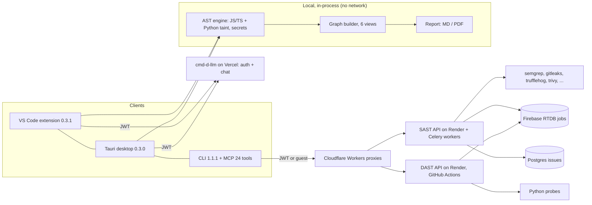

# Codefy Pitch Package: Audit, Evidence and Index

Prepared 2026-11-20. Everything here is traceable to a file, a test run, or a cited source. Where evidence is missing the item is labelled **FOUNDER-REPORTED**, **ESTIMATE**, **PROPOSAL** or **OPEN**.

## Contents

| Path | Purpose |
|---|---|
| `presentation/codefy-pitch-deck.pptx` | The 10-slide editable deck (16:9) |
| `presentation/sources-and-notes.md` | Slide-by-slide claim → source map and speaker notes |
| `presentation/legacy/` | Backups of the original `pitch-deck.html` / `.pdf` (originals left in place, untouched) |
| `research/` | Market, academic, competitor, pricing, cost, unit-economics, customer-validation files |
| `strategy/` | Positioning, India GTM + 90-day plan, roadmap |
| `evidence/` | Reproducible scripts, the demo project, benchmark and scan outputs |
| `assets/screenshots/original` and `/presentation` | Raw captures and the redacted/cropped versions used in the deck |
| `STARTUP_BUILDATHON_SUBMISSION.md` | Original submission, **unchanged** (see §3 for what in it is not supported) |

## 1. Product scope

"Codefy" is several repositories under `/Users/jayesh/Documents/`: the `codefy` monorepo (engine, UI, VS Code extension, Tauri desktop), `CLI` (npm `@mickey20/codefy`, MCP server), `codefy - whoami/{SAST,DAST,pipeline}` (backend APIs), `axiom` (orchestrator), `BugBound` (validation engine), `cmd-d_llm` (auth + LLM gateway) and `whoami_ui` (website, `axtion.tech`). The brand is split across Codefy, WhoAmI and Axtion.

## 2. Capability matrix

| Capability | Status | Implementation evidence | User value |
|---|---|---|---|
| **SAST, local** | IMPLEMENTED (narrow) | JS/TS: 5 rules (SQLi, command injection, SSRF, path traversal, code injection); Python: 5 rules; within-function tracing, ≤8 hops. `packages/core/src/{rules,taint}`; 41 core test files / 296 cases. **Seeded test: 3 of 5 found.** No XSS rule. | Instant, offline, no upload |
| **SAST, cloud** | PARTIAL | 25 tools catalogued (`SAST/worker/tools/catalog.py`); ~10 installed on the Render worker, missing tools fall back to Python checks. Live scan run 2026-11-20 (semgrep, gitleaks, trufflehog, trivy; 94 s). | Wider rule coverage |
| **Secret detection** | IMPLEMENTED | 3 regex patterns + entropy ≥ 4.0 (`packages/core/src/secrets`); gitleaks in cloud | Catches hard-coded keys |
| **DAST** | EXPERIMENTAL | Registry lists 30 "tools" but they are 27 lightweight Python HTTP probes, not the real binaries (`DAST/app/scanners/native/probes.py`). Passive scan run live: 2 true low findings. | Fast header/config checks |
| **Reconnaissance** | PARTIAL / remote only | Axiom `recon_pipeline.py` chains subfinder/amass/dnsx/httpx/katana/gau, falls back to crt.sh; most binaries not installed on runners. Nothing local. | Subdomain/endpoint discovery |
| **Vulnerability detection** | IMPLEMENTED (as above) | | |
| **Exploit validation** | EXPERIMENTAL, not in product | BugBound replays requests in-process (BOLA/BFLA/SQLi/SSRF); results only on its own benchmark app. Desktop PoC button returns "unavailable"; VS Code returns `verified:false`. | — |
| **Security reporting** | IMPLEMENTED | Markdown and PDF (jsPDF, client-side); SARIF for cloud jobs (the local report's SARIF button is not wired in either app); no HTML | CI and audit evidence |
| **Attack-path graphs** | IMPLEMENTED, 2 caveats | 6 views. "Control flow" is drawn from the finding's trace, not a real CFG; "Supply chain" uses placeholder packages | Understand a finding |
| **Patch / 1-click fix** | PARTIAL | Template snippets, not line-accurate diffs; VS Code applies by regex on the sink line; desktop cannot apply | Remediation hint |
| **LLM integration** | PARTIAL | Hosted chat via `cmd-d-llm.vercel.app` (free-tier models, e.g. Llama-3.2-1B), local fallback. `OpenRouterTriageProvider` exists but both apps hard-wire the no-LLM provider. **No Google or Gemini code anywhere.** | Chat explanations |
| **JEV integration** | PLANNED | No code or docs; defined only by the founder's flowchart (`strategy/product-roadmap.md`) | — |
| **Workflow orchestration** | PARTIAL | Celery + Redis (SAST), GitHub Actions dispatch (DAST), Axiom controller. **Kafka and Temporal: PLANNED**, not running. | Background scans |
| **MCP / CLI** | IMPLEMENTED | 24 tools / 3 resources / 4 prompts counted in code; `--fail-on` gating; no CLI tests | Agent and CI use |

## 3. Claims in the legacy deck and submission that are not supported

| Claim in `pitch-deck.html` / `STARTUP_BUILDATHON_SUBMISSION.md` | Finding |
|---|---|
| "<300 ms per keystroke taint pass" | No keystroke trigger exists (scans run on command). Measured instead: 0.2–0.4 ms per small file, 2.3 ms median per file on a 10k-LOC codebase |
| "41 LOC slice, 0.66% payload" | Appears only in the deck generator script. Code builds a metadata summary under 350 tokens, not an AST slice |
| Gemini 2.0 Flash / 1.5 Pro routing; Google AI Studio / Antigravity roles | No Gemini or Google SDK in any repo |
| "Entropy redaction + path anonymisation + AST slicing before any prompt" | Partial: 11 regex redaction patterns and path masking exist; entropy is used only by the local secret scanner; no AST slicing for prompts |
| "AST-validated 1-click diff" | Regex line rewrite; no parse check; desktop cannot apply |
| "Excalidraw format / Excalidraw Mermaid DAG" | No Excalidraw code; graphs use React Flow + ELK |
| "<5% false positives (design target)", "0% false positives (Oracle)" | No measured rate exists anywhere. The Oracle report shows zero findings; BugBound's own results are on its own test app. Our founder desktop history shows 156 of 246 findings were unresolved "needs-verification" SSRF |
| "85%+ of legacy SAST alerts are false positives (Sadowski, CACM 2018)" | Paper does not say this. It describes Google's 10% effective-false-positive ceiling |
| "35–55% LLM hallucination rate (Purba, arXiv:2403.04671)" | The arXiv ID belongs to an unrelated paper. The real Purba et al. paper (ISSREW 2023) does not give that figure |
| "10×–30× costlier after deployment (IBM SSI)" | Source never located; Menzies et al. 2016 found no such effect. Dropped |
| "25 SAST and 30 DAST tools / 55+ engines" | 25 catalogued, ~10 installed; DAST "tools" are probes. The CLI's catalogue is static |
| "TAM $18.4B, SAM $4.2B, SOM $450M; $1.2M ARR in Q3 2027" | Top-down, unsourced. Replaced by the bottom-up India model in `research/market-research.md` (TAM ₹5,416 cr, SAM ₹500 cr, SOM ₹4.6 cr, all estimates) |
| Pricing $29 / $89 per dev per month | Never validated. Replaced by INR proposals |
| "Extension: local runtime verification" (`package.json`) | Runtime verification is not implemented |
| "Desktop and CLI downloads for Windows/Linux, signed auto-update" | `whoami_ui/public/downloads` holds mostly placeholder files and a fake updater signature; only macOS arm64 builds look real |

The original files were **not edited**. Recommend correcting `docs/DETECTION-ENGINE-SPEC.md` (the Purba citation) and `apps/vscode-extension/package.json`'s description as separate product changes.

## 4. Architecture (current, evidence-based)



**Scan workflow (what happens on "Scan Folder", verified by running it):** pick folder → read ≤5,000 files via Tauri fs → send to a Web Worker → tree-sitter + ast-grep WASM parse → taint rules + secret scan → findings (confirmed or needs-verification) → workspace graph → UI list, detail card, graph, report. In offline mode nothing leaves the machine. Cloud mode additionally POSTs the code to the SAST API (which returns a job ID, streams progress and exports JSON/SARIF).

**Data flow:** findings are stored as JSON in `~/.codefy/` (desktop) or `globalState` (VS Code); cloud jobs live in Firebase RTDB (24-hour expiry) and Postgres issue tables.

## 5. Reproducing the evidence

```bash
# engine timing + fixture correctness
node docs/pitch/evidence/scripts/bench.mjs packages/core/dist-node/index.cjs packages/core/src/__tests__/fixtures/javascript <any-ts-dir>
# seeded-issue test
node docs/pitch/evidence/scripts/seeded.mjs packages/core/dist-node/index.cjs docs/pitch/evidence/demo-payments-api
# unit economics
python3 docs/pitch/research/unit_economics.py
```
Desktop screenshots were captured by running the real desktop frontend (Vite) in Chromium with only the Tauri file/dialog calls stubbed (`evidence/scripts/tauri-mock.js`) and the network blocked; the engine, UI and worker are the real code. Cloud results came from the real CLI against the live services.

## 6. Open items needing the founder

1. **1005 Labs:** redacted disclosure email, scan output, fix confirmation, written permission to be named, and what authorization preceded testing. Until then the deck anonymises it and badges it FOUNDER-REPORTED.
2. **"JEV":** what the acronym stands for.
3. **Contact details** for slide 10 (no email was published; none was invented).
4. **Active-user evidence:** Firebase/auth user export or analytics, if you want "5–10 active users" upgraded.
5. **Current monthly infrastructure bill** (the model uses list prices).
6. **The QA test:** input, environment and repetitions, to upgrade the one-second observation.
7. Confirm the brand to show (Codefy vs Axtion) and that `axtion.tech` is yours.
