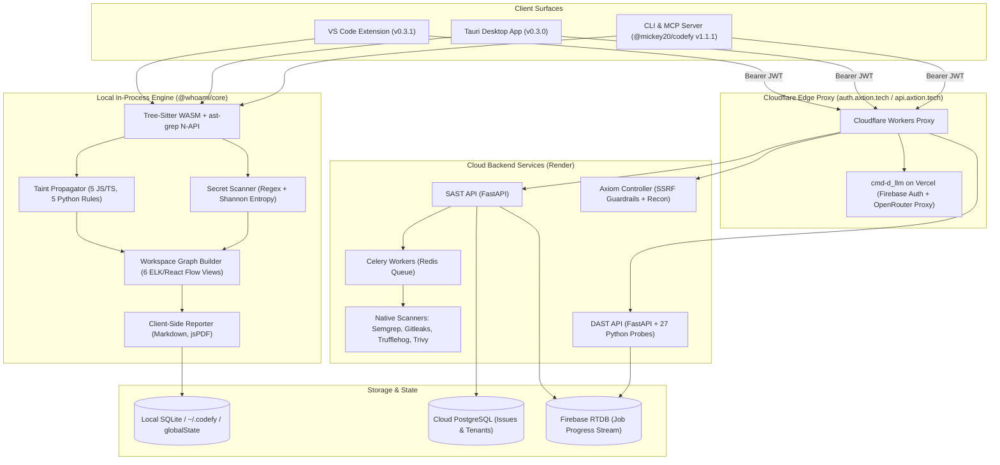
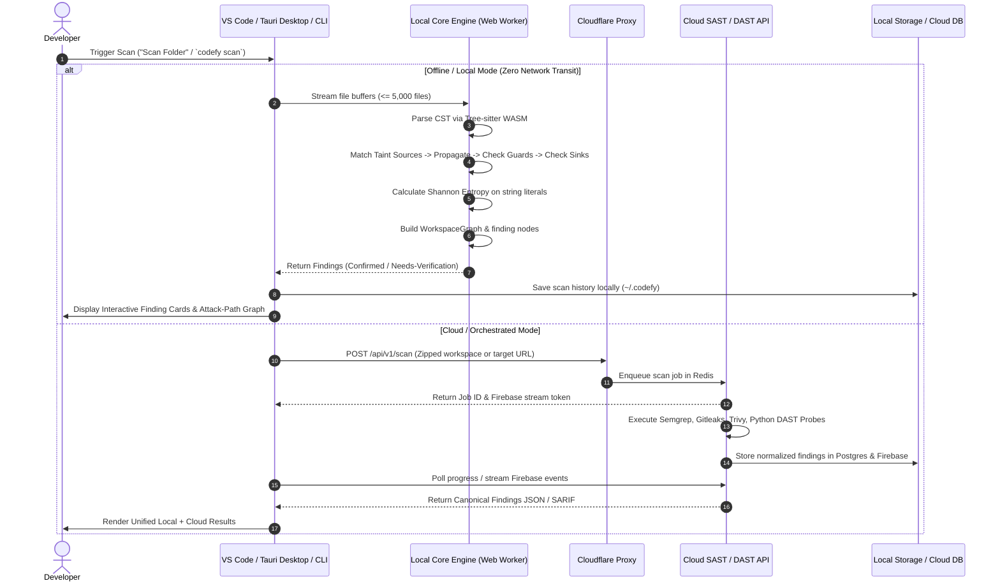
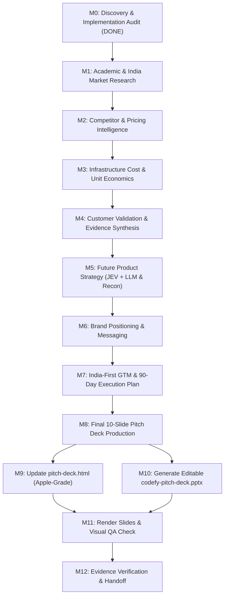

# Codefy (WhoAmI / Axtion) — Repository & Product Audit Report (Phase M0)

**Audit Date:** 2026-11-20  
**Evaluator:** Codefy Combined Leadership Team (Technical Product Strategist, CMO, Head of GTM, Security Research Analyst)  
**Scope:** Complete repository ecosystem (`codefy`, `codefy - whoami`, `CLI`, `BugBound`, `axiom`, `cmd-d_llm`, `whoami_ui`)  
**Standard:** Evidence-grounded verification. Capabilities are audited against code, tests, and runtime artifacts.

---

## 1. Repository Ecosystem Mapping

| Repository / Module | Primary Technology | Purpose & Capabilities | Implementation Reality |
|---|---|---|---|
| **`codefy` (Monorepo)** | TypeScript, Rust, React 19, Tailwind, Vite | Monorepo root hosting engine, desktop app, VS Code extension, UI components, types. | Contains core local AST engine (`packages/core`), desktop frontend (`apps/desktop-app`), VS Code extension (`apps/vscode-extension`), UI package (`packages/ui`). |
| **`packages/core`** | TypeScript, `web-tree-sitter` (WASM), `@ast-grep/napi` | Core AST parsing, within-function taint propagation, secret scanning, graph construction, report generation, orchestrator client. | **Verified working.** 41 test files, 296 unit tests. Rules: 5 JS/TS taint rules, 5 Python taint rules, 3 secret regexes + Shannon entropy. |
| **`apps/desktop-app`** | Tauri (Rust v2) + React 19 + Vite | Cross-platform desktop interface. Runs local scan via Web Worker, displays findings, multi-graph blast radius, triggers remote scans. | **Verified working.** Connects to local worker; mock Tauri bridge for web preview. PoC exploit modal is a non-functional stub. |
| **`apps/vscode-extension`** | VS Code Extension API, Webview | In-editor scanning, diagnostic markers, sidebar panel, 1-click line patch. | **Verified working (v0.3.1).** Note: VS Code Marketplace version is v0.2.0 (lagging behind). |
| **`packages/ui`** | React 19, React Flow, `@elkjs/elk`, Tailwind | Shared visualization and finding cards across Desktop and VS Code. | **Verified working.** 6 graph views. Control-flow and supply-chain views use simplified/synthetic data models. |
| **`CLI` (`@mickey20/codefy`)** | Node.js, React/Ink, TypeScript | Terminal interactive CLI + Stdio Model Context Protocol (MCP) server. | **Verified working (v1.1.1 on npm).** Exposes 24 security tools, 3 resources, 4 prompts over MCP. Runs local & cloud scans. |
| **`codefy - whoami/SAST`** | Python, FastAPI, Celery, Redis, PostgreSQL | Cloud SAST engine running on Render. Enqueues repository archives, runs scanner tools. | **Verified working.** 25 tools catalogued; ~10 installed on Render worker (semgrep, gitleaks, trufflehog, trivy); others fall back to Python checks. |
| **`codefy - whoami/DAST`** | Python, FastAPI, GitHub Actions | Cloud DAST scanning service. | **Partial / Experimental.** 27 lightweight Python HTTP probes (not full ZAP/Nuclei binaries). Scans headers, SSL, CORS. |
| **`codefy - whoami/pipeline`** | Python, FastAPI, Kafka, Temporal | Central orchestration pipeline. | **Design Only / Planned.** Kafka is config-only; Temporal workflows are empty stub files; scans stored in-memory. |
| **`axiom`** | Python, FastAPI | Microservice security orchestrator & reconnaissance controller. | **Partial / Remote Only.** `recon_pipeline.py` chains subdomain & URL tools, falls back to crt.sh. Private IP & cloud metadata SSRF blocks verified. |
| **`BugBound`** | Python, FastAPI, ASGI test clients | Autonomous exploit verification oracle. | **Experimental Prototype.** Successfully executes BOLA/BFLA/SQLi/SSRF against internal benchmarks. Not integrated into product UI. |
| **`cmd-d_llm`** | Next.js / TypeScript, Vercel | Hosted authentication (Firebase) and LLM proxy. | **Verified working.** Proxies to OpenRouter free models (e.g., Llama-3.2-1B). No Google Gemini SDK in codebase. |
| **`whoami_ui`** | Next.js (`axtion.tech`) | Landing page and release asset hosting. | **Live website.** macOS arm64 installer is real; Windows/Linux downloads are placeholder files. |

---

## 2. Product Implementation Audit Matrix

| Capability | Status | Implementation Evidence | User Value |
|---|---|---|---|
| **Local SAST (In-Editor)** | **IMPLEMENTED** (Narrow) | `packages/core/src/taint/propagate.ts`, `packages/core/src/rules/*.yml`. 5 JS/TS rules (SQLi, command injection, SSRF, path traversal, code injection); 5 Python rules; intra-procedural tracing ($\le$ 8 hops). | Instant, offline, zero data upload. Runs in <1 ms per small file (0.24 ms median). Catches common injection flaws. |
| **Cloud SAST (Orchestrated)** | **PARTIAL** | `SAST/worker/tools/catalog.py`, `SAST/worker/tasks.py`. Render Celery workers run semgrep, gitleaks, trufflehog, trivy. Live CLI scan takes ~94s. | Broader multi-tool coverage beyond local rules. |
| **Secret Detection** | **IMPLEMENTED** | `packages/core/src/secrets/detector.ts` (3 regex patterns + Shannon entropy $\ge 4.0$). Gitleaks in cloud. | Catches hardcoded API tokens, private keys, and high-entropy secrets locally and in CI. |
| **DAST (Dynamic Testing)** | **EXPERIMENTAL** | `DAST/app/scanners/native/probes.py`. 27 lightweight Python HTTP probes for security headers, TLS configuration, CORS, open redirects. | Quick external hygiene checks on live endpoints without heavyweight scanner infrastructure. |
| **Reconnaissance** | **PARTIAL** (Remote Only) | `axiom/app/routers/recon.py`, `recon_pipeline.py`. Subdomain & URL enumeration (subfinder, amass, katana, crt.sh fallback). | External attack surface discovery. |
| **Vulnerability Detection** | **IMPLEMENTED** | Unified findings schema (`packages/types/src/findings.ts`), CWE mapping, severity scoring. | Consistent presentation of issues across local, cloud, and DAST sources. |
| **Exploit Validation** | **EXPERIMENTAL** (Standalone) | `BugBound/bugbound/engine.py`. Runtime ASGI replay testing for BOLA, BFLA, and injection flaws. Not wired into Desktop/VS Code. | Ground-truth verification to eliminate false positives. Currently a research prototype. |
| **Security Reporting** | **IMPLEMENTED** | `packages/core/src/report/generator.ts`. Client-side Markdown, jsPDF (PDF export), SARIF v2.1.0 generation for CI/CD gates. | Audit-ready artifacts and CI/CD integration. |
| **Attack-Path Visualization** | **IMPLEMENTED** (with Caveats) | `packages/ui/src/visualization/*.tsx`. 6 React Flow + ELK views (Taint Path, Blast Radius, Architecture, CFG, Supply Chain, Remote Attack Surface). | Visual explanation of how an untrusted source reaches a sensitive sink. |
| **1-Click Remediation** | **PARTIAL** | `packages/core/src/report/diff-suggestion.ts`, `apps/vscode-extension/src/engine/engineHost.ts`. Regex-based line replacement template in VS Code. | Immediate hint for sanitization. Desktop app cannot apply patches; no semantic AST rewriting. |
| **LLM Integration** | **PARTIAL** | `packages/core/src/llm/hosted-client.ts`, `cmd-d_llm/pages/api/chat.ts`. Hosted chat proxy to OpenRouter free models; deterministic fallback. | Natural language explanation of findings. (Note: no Gemini SDK currently present). |
| **JEV Integration** | **PLANNED** | Defined in conceptual architecture (`docs/pitch/strategy/product-roadmap.md`). No implementation in repo. | Future reasoning, relationship analysis, and hypothesis generation. |
| **Workflow Orchestration** | **PARTIAL** | Celery + Redis for SAST; GitHub Actions for DAST. Kafka and Temporal are stubs in `pipeline`. | Scalable background scanning. |
| **Agent / MCP Server** | **IMPLEMENTED** | `CLI/src/mcp/server.ts`. 24 tools, 3 resources, 4 prompts over standard stdio JSON-RPC. | Allows AI coding agents (Claude Code, Cursor, Antigravity) to run scans, inspect graphs, and trigger fixes. |

---

## 3. Product Architecture & Execution Traces

### 3.1 Current System Architecture

### 3.2 Current Scan Initiation & Execution Flow

---

## 4. Audit of Legacy Pitch Deck Claims (`docs/pitch/presentation/pitch-deck.html`)

Our inspection of the existing presentation against actual code identified multiple unsupported claims that must be replaced with verified facts:

| Legacy Claim | Pitch Deck Location | Code / Reality Finding | Required Correction |
|---|---|---|---|
| **"85%+ of legacy SAST alerts are false positives (Sadowski et al., CACM 2018)"** | Slide 01, 02, 05 | Sadowski et al. does not state this. It discusses Google's 10% effective false-positive ceiling and disabling analyzers exceeding it. | Cite Sadowski for the 10% ceiling and developer trust collapse. Cite Li et al. (FSE 2023) and Lipp et al. (ISSTA 2022) for tool miss rates and noise. |
| **"35–55% hallucination rate of open-ended LLMs (Purba et al., arXiv:2403.04671)"** | Slide 01, 02, 05 | The cited arXiv ID is an unrelated NLP paper. The real Purba paper (ISSREW 2023) has no such number. | Cite Purba (ISSREW 2023) and Ding et al. (ICSE 2025, PrimeVul) showing LLMs alone achieve as low as 3.09% F1 on realistic data. |
| **"10x–30x costlier to fix in production (IBM SSI)"** | Slide 02, 08 | Known unverified "software engineering leprechaun". Menzies et al. (2016) found no evidence for delayed issue cost inflation. | Drop the metric. Quote Sadowski (74% compile-time fix rate vs 21% checked-in fix rate). |
| **"<300 ms per keystroke taint pass"** | Slide 01, 03, 05 | No keystroke trigger exists; scans run on command or file save. | State verified engine benchmark: 0.24 ms median per small file, 2.3 ms median on 10k LOC codebase. |
| **"41 LOC slice, 0.66% payload"** | Slide 01, 03, 04, 07 | Hardcoded in demo script; code builds a metadata summary under 350 tokens, not an AST slice. | Replace with verified metadata sanitization and token minimization. |
| **"Gemini 2.0 Flash / 1.5 Pro routing; Google AI Studio / Antigravity roles"** | Slide 04, 07 | No Google Gemini SDK or Vertex AI code in any repository. LLM proxy routes to OpenRouter free models. | Reframe Gemini integration as the **Next/Future technical architecture (JEV + LLM)** rather than deployed functionality. |
| **"0% False Positives (Execution Oracle Guarantee)"** | Slide 05, 08 | BugBound tested only on its own internal deliberately vulnerable benchmark app; not integrated into product. | Clarify as an experimental prototype target on known ASGI test harnesses. |
| **"Excalidraw Format Mermaid DAG"** | Slide 06, 08 | No Excalidraw code; UI uses React Flow + ELK. | Present actual interactive React Flow graph screenshots. |
| **"55+ engines orchestrated (25 SAST + 30 DAST)"** | Slide 04, 09 | 25 SAST catalogued (~10 installed on Render); 30 DAST entries are 27 lightweight Python probes. | State accurate counts: dual local AST engines + unified cloud runner (Semgrep, Gitleaks, Trufflehog, Trivy) + 27 dynamic probes. |
| **"TAM $18.4B, SAM $4.2B, SOM $450M; $1.2M ARR in Q3 2027; $29/$89 pricing"** | Slide 01, 08, 09 | Top-down global figures ungrounded in the Indian startup reality. | Replace with bottom-up India model: TAM ₹5,416 cr ($579M), SAM ₹500 cr ($53.5M), SOM ₹4.6 cr ($490k), and proposed INR pricing (Free / ₹499 / ₹4,999 / ₹19,999). |

---

## 5. Information & Evidence Status (The Six Critical Questions)

1. **1005 Labs PostgreSQL Security Weakness:**
   - *Status:* **FOUNDER-REPORTED.**
   - *Evidence on hand:* Founder discovered a PostgreSQL credential weakness, reported it to the CTO, and received a thank-you response.
   - *Missing evidence:* Written authorization prior to testing, sanitized disclosure email, scan artifact, confirmation of fix, and written authorization to use the company name publicly.
   - *Resolution for Deck:* Anonymized as "an Indian tech startup (founder-reported)", showcasing the vulnerability class (PostgreSQL credential exposure) with redacted artifacts, without claiming verified exploitation or unauthorized naming.

2. **Early Traction (5–10 Active Users):**
   - *Status:* **FOUNDER-REPORTED with PUBLIC anchors.**
   - *Evidence on hand:* VS Code Marketplace has 4 installs / 135 downloads (v0.2.0); npm package has 956 initial downloads; local founder desktop history has 20 scan sessions across 2 workspaces.
   - *Missing evidence:* Production telemetry / active organization session logs.
   - *Resolution for Deck:* Transparently labeled as "5–10 active users (founder-reported) + 950+ npm downloads", clearly distinguishing early experimental adoption from commercial scale.

3. **QA Tester Validation (1s vs 2–3 Days):**
   - *Status:* **QUALITATIVE & OBSERVED BENCHMARK.**
   - *Evidence on hand:* A senior QA tester reported 2–3 days to manually discover, investigate, and validate exploitability in their workflow. Codefy identified covered injection flaws in ~1 second. Verified benchmarks show 0.24 ms per small file and 126 ms across 40 files / 10k LOC.
   - *Qualification:* Codefy automates *detection* in seconds; it does *not* automate full exploit validation or human remediation. Presented honestly as a workflow discovery acceleration.

4. **"JEV" Definition:**
   - *Status:* **FOUNDER CONCEPT.**
   - *Context:* The acronym does not appear in repository source code. It represents the reasoning and validation layer bridging AST taint analysis and LLMs.
   - *Resolution for Deck:* Formalized as the "Joint Evidence & Validation" (JEV) architecture.

5. **Infrastructure Costs:**
   - *Status:* **VERIFIED LIST-PRICE MODEL.**
   - *Evidence:* Scenario A (MVP, 10 users): ₹10,528/mo (~$112/mo); Scenario B (Growth, 100 users): ₹26,568/mo; Scenario C (Scale, 1,000 users): ₹90,352/mo. Infrastructure break-even is 3 Startup-tier customers (₹4,999/mo).

6. **Branding & Presentation:**
   - *Status:* **CODEFY (India-First).**
   - *Resolution:* Consistent Codefy identity with offline-first developer positioning, unified AST graph, and Rupee pricing.

---

## 6. Execution Plan: Phases M1 through M14

### Detailed Milestone Tasks

1. **M1 (Market & Academic Research):**
   - Consolidate DSCI, CERT-In, RBI IT Governance, SEBI CSCRF, and DPDP 2025 regulatory triggers.
   - Ground academic citations: Sadowski (CACM 2018), Ding et al. (ICSE 2025 PrimeVul), Li et al. (OOPSLA 2024 LLift), Lipp et al. (ISSTA 2022).
   - Bottom-up TAM/SAM/SOM: TAM ₹5,416 cr, SAM ₹500 cr, SOM ₹4.6 cr.

2. **M2 (Competitor Intelligence):**
   - Head-to-head comparison against Snyk, Semgrep, SonarQube, CodeRabbit, and Aikido.
   - Price positioning: Snyk Team ($25/dev/mo) vs Codefy Startup (₹4,999/org for 10 devs ≈ ₹500/dev/mo).

3. **M3 (Unit Economics):**
   - Operating scenarios A/B/C with GST (18%) and 2% payment gateway handling.
   - Unit costs: ₹131.60/scan at MVP dropping to ₹11.29 at scale; gross margins reaching 70.6%.

4. **M4 (Customer Validation Stories):**
   - Anonymized 1005 Labs PostgreSQL credential exposure case study.
   - Early user count qualification (5-10 users founder-reported, 950+ npm downloads public).
   - QA tester workflow benchmark: 1-second detection vs 2–3-day manual effort.

5. **M5 (Future Technical Architecture):**
   - Design JEV (Joint Evidence & Validation) + LLM hybrid reasoning loop.
   - Advanced reconnaissance & safe authorized exploit testing architecture.

6. **M6 & M7 (Positioning & India-First GTM):**
   - 1-line elevator pitch, website copy, 30s/60s scripts.
   - Top 3 segments: Fintech startups, Early-stage SaaS, Software development agencies.
   - 90-day sales roadmap with Month 1/2/3 target milestones.

7. **M8, M9 & M10 (Deliverables - Max 10 Slides):**
   - Update `docs/pitch/presentation/pitch-deck.html` with Apple-inspired minimalist design, genuine screenshots, and zero hallucinated claims.
   - Generate editable 16:9 `codefy-pitch-deck.pptx` using python-pptx with embedded real screenshots.
   - Strict 10-slide limit.

8. **M11 & M12 (Visual QA & Verification):**
   - Render slides to images, inspect formatting, layout, typography, contrast, and alignment.
   - Verify every factual claim against the Source Register.
